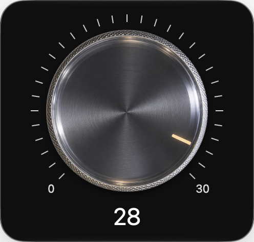

# Volufier

Volufier puts the hardware volume dial of your Edifier MR5 speakers in the Mac menu bar. Keep the 3.5 mm cable plugged in for audio. Volufier uses Bluetooth Low Energy to adjust the speakers themselves, just as turning the dial on the front would.

[Download Volufier for Apple silicon](https://github.com/hspmn/Volufier/releases/latest) · [Release notes](https://github.com/hspmn/Volufier/releases/tag/v1.4)

<p></p>
<p></p>

## Getting started

1. Download the ZIP from Releases, unzip it and move **Volufier.app** to Applications.
2. Turn on the MR5s, open Volufier and allow Bluetooth access when macOS asks.
3. Click the pair of speakers in the menu bar to adjust the volume. Right-click the icon for **Settings** or **Quit**.

The downloadable app is Developer ID signed. This build has not been notarised by Apple.

The release build targets **Apple silicon and macOS 13 or later**. Hardware testing used an Edifier MR5 and macOS 27.2. Older supported versions use a translucent material in place of Liquid Glass.

## Volume and sound

Choose the native slider or a rotary dial in Settings. The dial rotates through 30 increments from zero to full volume. Drag the knob, click a notch, or use the arrow keys for one-step adjustments. The panel opens beneath the menu bar on the display you clicked.

Open **Settings → Advanced** for the speaker controls.

| Control | What it changes |
| --- | --- |
| Sound mode | Switch between Monitor, Music and Custom. |
| Nine-band equaliser | Drag a point from 62 Hz to 16 kHz to adjust that band. Select Custom to hear the curve. The vertical scale shows gain steps from flat. |
| Room tuning | Set the low-cut frequency and slope, compensate for placement near walls, or enable desktop reflection compensation. |
| Automatic power saving | Enable or disable the speakers’ own power-saving setting. |

## Bluetooth and the phone app

**Keep speakers connected** is on by default. Volufier keeps a low-energy control connection open between adjustments and listens for changes from the speakers. **Open at login** starts Volufier in the menu bar when you sign in.

The MR5 accepts one control client at a time. To use Edifier ConneX on your phone, turn off **Keep speakers connected** and close the volume panel and Advanced, or quit Volufier. If discovery takes longer than expected, wake the speakers and close ConneX on the phone. [MR5 hardware findings](https://github.com/68776877/Edifier-IR-remote#one-control-client-at-a-time)

## Build from source

On an Apple silicon Mac with full Xcode installed, run the following commands from the repository root. The release was built with the macOS 27.2 SDK. The build uses Apple frameworks and the Swift compiler supplied with Xcode.

```sh
./scripts/test.sh
./scripts/build.sh
open build/Volufier.app
```

The build produces a locally signed app and a ZIP in `build/`. Developers making a distribution build can set `SIGNING_IDENTITY` to their own Developer ID Application certificate. The tests cover message framing, hardware-setting ranges, dial geometry and multi-display placement. They run without speakers attached.

## Protocol references

Volufier is an independent project. Edifier publishes the MR5’s supported features. Community implementations document the Bluetooth messages used to control them.

- [Edifier MR5 product and manual](https://www.edifier.com/int/global/p/studio-monitors/mr5)
- [MR5 volume protocol and captured frames](https://github.com/68776877/Edifier-IR-remote/blob/main/PROTOCOL.md)
- [MR5 sound modes, equaliser and room tuning](https://github.com/Devis99/omarchy-edifier-mr5)
- [Edifier MR protocol notes, including power saving](https://github.com/tomcoolpxl/edifier-mr-volume/blob/main/docs/PROTOCOL.md)

## Licence

[MIT](LICENSE)
